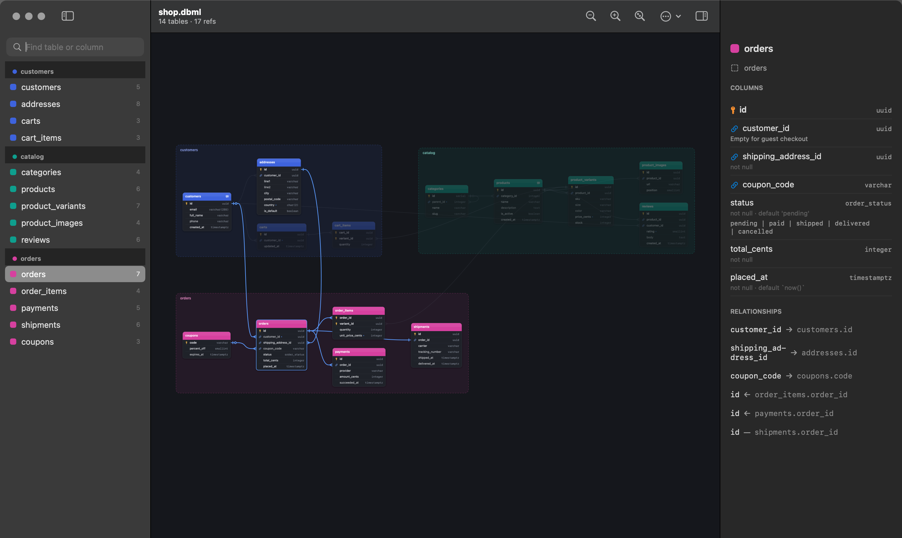
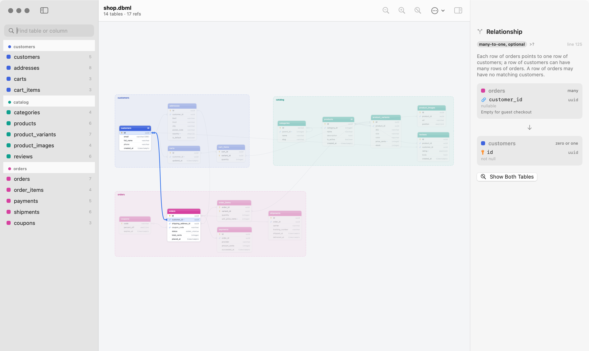
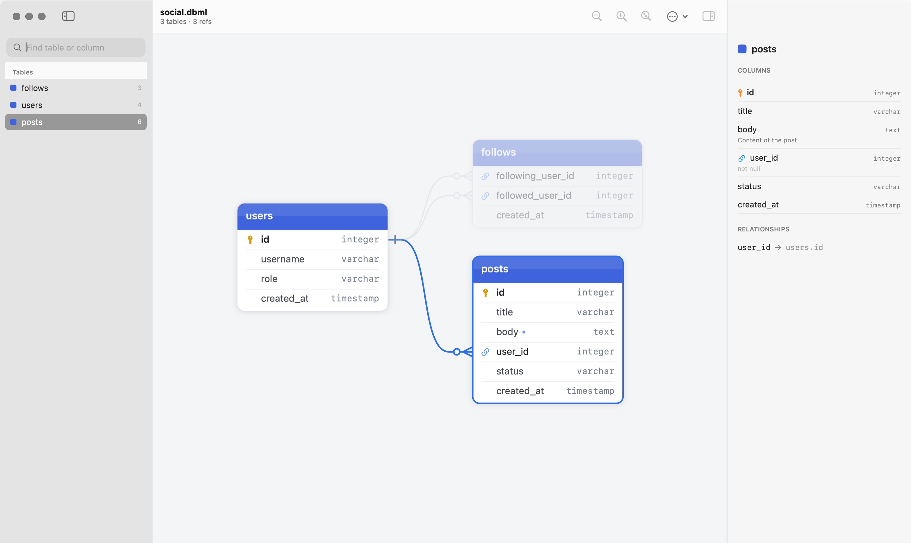

# DBGram

A fast, native macOS viewer for database diagrams written in **DBML**, the schema language behind
[dbdiagram.io](https://dbdiagram.io).

I built it because big schemas got too slow to view in the browser. DBGram opens the same `.dbml`
files you write for dbdiagram.io and draws them natively, so panning and zooming stay smooth even with
hundreds of tables.



> **About DBML and dbdiagram.io.** DBGram reads the [DBML syntax](https://dbml.dbdiagram.io/docs/)
> created by [Holistics](https://www.holistics.io) for [dbdiagram.io](https://dbdiagram.io). Schemas written
> for dbdiagram.io should open here as they are. DBGram is an independent project and is not affiliated with
> dbdiagram.io or Holistics. If you want an online editor, sharing or SQL export, use dbdiagram.io.

## Features

- **Fast.** Each table is drawn once into a cached Core Animation layer, so pan, zoom and drag only move
  GPU textures. Parsing plus layout of 1,500 tables (32k lines) takes about 200 ms.
- **Live reload.** Keep editing the `.dbml` in your editor; every open window updates when you save.
  This works with editors that save by replacing the file, and with files that are deleted and recreated
  (e.g. by `git checkout`). Tables you dragged stay where you put them.
- **Auto layout in three styles** (the Arrange button in the toolbar):
  - **Left to Right:** referenced tables on the left, the tables pointing at them on the right, folded to
    fit the screen. Each `TableGroup` becomes its own colored cluster.
  - **Pipeline:** one left-to-right flow along the data lineage. Each `TableGroup` is a stage with its
    tables stacked in a column.
  - **Compact:** as little empty space as possible, with related tables next to each other.

  Each file remembers its style, and ⌘Z undoes an arrange.
- **Table groups on their own.** Pick a `TableGroup` in the toolbar picker to see only its tables and the
  relationships between them; switch with ⌘[ / ⌘]. Every view shares one layout, so a table moved in a
  group view moves in the full diagram too.
- **Relationships you can inspect.** Click a line to highlight it and its two columns, and read it in plain
  words: one/many, optional ends, `on delete` / `on update`.
- **Notes everywhere.** Hover a column or table header to read its note; the inspector shows notes,
  indexes and enum values.
- **DBML support:** tables, schemas and aliases, column settings, inline and standalone refs (including
  composite and optional `?` refs), indexes, enums, `TableGroup`, `TablePartial`, notes, `headercolor`,
  `Project`, and `Records` (skipped). Broken lines are listed with line numbers, and the rest still renders.
- **Light and dark mode**, PNG export (the whole diagram or just the visible area), find (⌘F), paste DBML from the clipboard.

| Click a relationship | Small schemas too |
| --- | --- |
|  |  |

## Install

Download the latest `DBGram-*.zip` from [Releases](https://github.com/n1klion/dbgram/releases), unzip it and move `DBGram.app` to
`/Applications`.

The app is not notarized, so macOS blocks it the first time you open it. Right-click it and choose
**Open**, or allow it under **System Settings → Privacy & Security → Open Anyway**. You can also clear the
quarantine flag:

```sh
xattr -dr com.apple.quarantine /Applications/DBGram.app
```

Requires macOS 14 or later, on Apple Silicon or Intel.

## Try it

Open one of the sample schemas in [`samples/`](samples):

- [`social.dbml`](samples/social.dbml): the dbdiagram.io starter schema (users, posts, follows).
- [`shop.dbml`](samples/shop.dbml): an online shop with groups, colors, notes, enums and optional refs.

```sh
open -a DBGram samples/shop.dbml
```

## Controls

| Action | How |
| --- | --- |
| Pan | two-finger scroll, space + drag, or right-drag |
| Zoom | pinch, ⌘/ctrl + scroll, mouse wheel, ⌘= / ⌘- |
| Fit / 100% | ⌘0 or `F` / ⌘1 |
| Find a table or column | ⌘F, then Enter |
| Focus a table | double-click it, or click it in the sidebar |
| Inspect a relationship | click its line; double-click to zoom to both tables |
| Move a table | drag it (saved per file in `~/Library/Application Support/DBGram`) |
| Select several tables | drag a rectangle on the background (⇧ adds to the selection), ⌘-click or ⇧-click (canvas or sidebar), ⌘A |
| Move the selection | drag any selected table, or arrow keys (⇧ = 10 pt) |
| Undo / redo a move or an auto-arrange | ⌘Z / ⌘⇧Z |
| Show one table group | the picker in the toolbar, or ⌘[ / ⌘] |
| Re-arrange everything | ⌘⇧L or the Arrange button (its arrow picks Left to Right, Pipeline or Compact) |
| Paste DBML from the clipboard | ⌘⇧V |
| Export PNG: whole diagram / visible area | ⌘⇧E / ⌥⌘⇧E |
| Clear the selection | Esc |

## Build from source

Tested with Xcode 26 (Swift 6).

```sh
scripts/build-app.sh              # -> build/DBGram.app
scripts/build-app.sh --install    # also copies it to /Applications and registers .dbml files
scripts/build-app.sh --universal  # Apple Silicon + Intel binary
```

Development:

```sh
swift run DBGram samples/shop.dbml
swift test
scripts/screenshots.sh            # regenerates the images in docs/images
```

Render a diagram to PNG without opening a window:

```sh
DBGram --render schema.dbml out.png [--dark] [--scale 2]
```

### Branches and releases

The project uses git flow:

- **`develop`**: work in progress. Every push runs the tests and builds the app; the zip is attached to
  the workflow run under **Artifacts**, so it can be tested before a release.
- **`main`**: released code only. It changes only by merging a release.

To release, go to **Actions → Start release → Run workflow** and pick `patch`, `minor` or `major`, or
type an exact version such as `1.0.0-beta.1`. The workflow:

1. creates `release/vX.Y.Z` from `develop` and opens a pull request into `main`;
2. tests and builds that branch, so you can try the app before merging. Fixes can still be pushed to
   the branch.

Merging the pull request runs `release-publish.yml`. It tags the merge commit `vX.Y.Z`, builds the app,
publishes a GitHub Release with the zip and generated notes, merges `main` back into `develop`, and
deletes the release branch.

Versions starting with `0.` and versions with a suffix (`v1.0.0-beta.1`) are published as
**pre-releases**. Pushing a tag by hand (`git tag v0.2.0 && git push origin v0.2.0`) also publishes
a release.

### Project layout

- `Sources/DBMLKit`: DBML lexer, parser and model, plus the layered auto-layout. Pure Swift, no UI.
- `Sources/DBGram`: the app. It contains the AppKit canvas (`DiagramCanvas`), table drawing, file
  watching and the SwiftUI window.
- `samples/`: example schemas, also parsed by the tests.
- `scripts/`: app bundling, screenshots, and `gen-stress.py` for big synthetic schemas.

## License

DBGram is released under the [MIT License](LICENSE). DBML and dbdiagram.io belong to Holistics;
DBGram only reads the DBML format.
